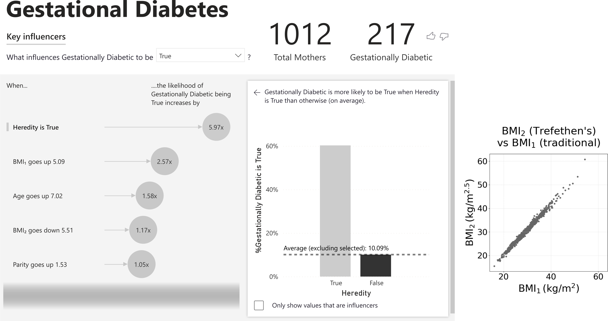

# Styling Microsoft Power BI dashboards with TeX

This repository holds digital resources associated with the article "Styling
Microsoft Power BI dashboards with TeX" [[1](#references)]. That article
describes how TeX may be used in Power BI to style business intelligence
dashboards. A gestational diabetes dataset was used to demonstrate both
desktop, and cloud-based, TeX-styled dashboard rendering.

---

<figure>
  
  <figcaption>Figure 1. TeX-styled Power BI dashboard for a gestational diabetes dataset.</figcaption>
</figure>

---

## Table of Contents

- [Key Files](#key-files)
- [Software Requirements](#software-requirements)
- [Getting Started](#getting-started)
- [Quality Assurance](#quality-assurance)
- [Acknowledgements](#acknowledgements)
- [References](#references)
- [Citation](#citation)
- [License](#license)

## Key Files

| File                          | Notes               |
| :---------------------------- | :------------------ |
| `src/GreyNeutralTheme.json`   | Power BI theme.     |
| `src/TexStyledDashboard.pbix` | Power BI dashboard. |

The Power BI dashboard holds native visuals and a Matplotlib scatterplot. An
example gestational diabetes dataset is embedded. The scatterplot showcases
TeX-styling visuals compatible with both local (Power BI Desktop) and online
(Power BI) rendering. The accompanying, grey-based theme provides accessibility
to colour-blind users.

## Software Requirements

| Software                   | Notes                                                                                                                                                              |
| :------------------------- | :----------------------------------------------------------------------------------------------------------------------------------------------------------------- |
| Power BI\* &nbsp;       | [Details here](https://www.microsoft.com/en-au/power-platform/products/power-bi). Free and fee-based options available. &nbsp;&nbsp;&nbsp;For online rendering. |
| Power BI Desktop &nbsp; | [Details here](https://www.microsoft.com/en-au/power-platform/products/power-bi/desktop). Free. &nbsp;&nbsp;&nbsp;For local rendering.                          |
| Python &nbsp;           | [Available here](https://www.python.org/). Free. &nbsp;&nbsp;&nbsp;For local rendering.                                                                         |

\* The associated article [[1](#references)] refers to the "Power BI Service".
At the time of publication, the Power BI Service was an independent service.
It's now part of Microsoft Fabric and referred to as simply, "Power BI".

### Python Configuration

As the dashboard uses Python-enabled visuals, Power BI should be configured to
execute Python. To do this, from the Power BI Desktop main menu, go to:

- File -> Options and settings -> Options -> Global -> Python scripting.
- Specify a valid path to the home directory of a Python installation.

Please ensure the Python environment has the following packages installed:

- matplotlib.
- pandas.

## Getting Started

### Local Rendering

For local dashboard rendering, open `TexStyledDashboard.pbix` with Power BI
Desktop.

### Online Rendering

For online dashboard rendering, open `TexStyledDashboard.pbix` from Power BI.

## Quality Assurance

The repository code was tested when the associated article [[1](#references)]
was released. It has since undergone further testing against newer releases of
supporting technologies. Details are given below.

Windows Test Environment, Publication

 

| Type            | Component        | Version       |
| :-------------- | :--------------- | :------------ |
| Platform        | Operating system | Windows 11    |
| Software        | Microsoft Edge   | 134.0.3124.72 |
| &quot;          | Power BI         | -             |
| &quot;          | Python           | 3.13.2        |
| Python Packages | matplotlib       | -             |

<!-- jscpd:ignore-start -->

Windows Test Environment, Post-Publication

 

| Type            | Component        | Version                                 |
| :-------------- | :--------------- | :-------------------------------------- |
| Platform        | Operating system | Windows 11, 26H2 (OS Build 26300.10075) |
| Software        | Power BI Desktop | 2.159.1231.0 64-bit                     |
| &quot;          | Python           | 3.14.10                                 |
| Python Packages | matplotlib       | 3.11.2                                  |
| &quot;          | pandas           | 3.1.0                                   |

<!-- jscpd:ignore-end -->

## Acknowledgements

A third-party gestational diabetes dataset was used, licensed under
[CC BY-SA 4.0](https://creativecommons.org/licenses/by-sa/4.0/legalcode.en).
Source: [R. Jader](https://www.kaggle.com/rasooljader). [Gestational Diabetes](https://doi.org/10.34740/KAGGLE/DSV/8301853).
Kaggle, 2024. doi: doi.org/10.34740/KAGGLE/DSV/8301853.

Some dataset transformations were made, including column renaming, data type
conversion and addition of new computed columns via Data Analysis Expressions
(DAX).

## References

1. T. Stenborg, "Styling Microsoft Power BI dashboards with TeX", _TUGboat_,
   vol. 46, no. 1, pp. 156&ndash;157, Apr. 2025, doi:
   10.47397/tb/46-1/tb142stenborg-powerbi.\
   [View PDF](https://tug.org/TUGboat/tb46-1/tb142stenborg-powerbi.pdf) &nbsp;
   [View at publisher](https://tug.org/TUGboat/tb46-1/tb142stenborg-powerbi.html)
   &nbsp; [SciX](https://scixplorer.org/abs/2025TUGbt..46..156S/abstract)

## Citation

Citation details are available by clicking **Cite this repository** in the
GitHub sidebar.

## License

This repository is licensed under the Creative Commons Attribution-ShareAlike
4.0 International ([CC BY-SA 4.0](https://creativecommons.org/licenses/by-sa/4.0/legalcode.en))
license. The associated [deed](https://creativecommons.org/licenses/by-sa/4.0/deed.en)
highlights key features of the license.

### Attribution

If you use, share or adapt material in this repository, you must give
[appropriate credit](https://creativecommons.org/licenses/by-sa/4.0/deed.en#ref-appropriate-credit),
[indicate if changes were made](https://creativecommons.org/licenses/by-sa/4.0/deed.en#ref-indicate-changes),
use a [compatible license](https://creativecommons.org/licenses/by-sa/4.0/deed.en#ref-same-license)
and provide a link to the license.
